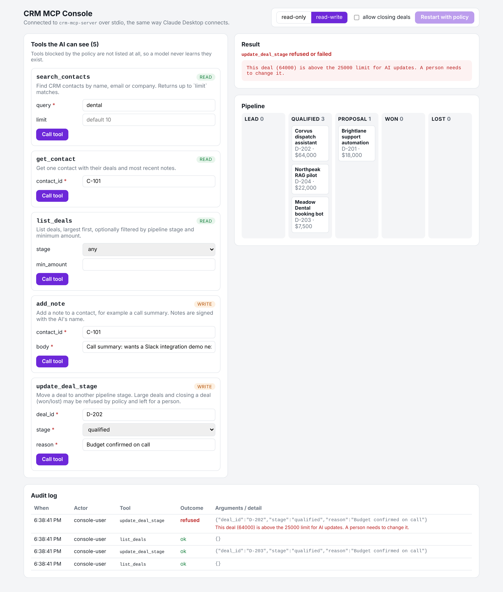

# CRM MCP Server

[](https://github.com/hassan-forge/crm-mcp-server/actions/workflows/ci.yml)


An [MCP](https://modelcontextprotocol.io) server that lets Claude, ChatGPT or your own agent work with CRM data: find contacts, read deals, log call notes and move deals through the pipeline, within limits your team sets.

It's a reference project showing how I connect AI to a company's systems. Giving a model access is the easy part. The real work is deciding what it can see, what it can change, and keeping a record of everything it did.

```
You: Which qualified deals over $20k do we have, and what's the latest on Corvus?

Claude → list_deals {stage: "qualified", min_amount: 20000}
Claude → get_contact {contact_id: "C-102"}

Claude: Two qualified deals over $20k: Corvus dispatch assistant ($64,000) and Northpeak RAG pilot ($22,000).
        Latest on Corvus: their dispatchers spend about 3 hours a day re-keying loads from email,
        and budget is approved for Q1.
```

## Web console

The repo also includes a **Next.js console** in `web/`. It starts the server as a child process and talks to it over stdio, exactly the way Claude Desktop does, so everything you see goes through the real protocol, policy and audit log.

- See which tools the AI is allowed to see under the current policy, and call any of them from a form
- Switch between read-only and read-write, or allow closing deals, and restart the server with that policy
- Watch the deal pipeline change when a write succeeds
- Read the audit log, with refused calls and the reason for each



```bash
npm install && npm run build   # build the MCP server first
cd web
npm install
npm run dev                    # http://localhost:3000
```

Or with Docker, from the repository root:

```bash
docker build -f web/Dockerfile -t crm-mcp-console .
docker run -p 3000:3000 crm-mcp-console
```

## Tools

| Tool | Type | What it does |
|---|---|---|
| `search_contacts` | read | Find contacts by name, email or company |
| `get_contact` | read | One contact with their deals and recent notes |
| `list_deals` | read | Deals by stage and minimum amount, largest first |
| `add_note` | write | Add a note to a contact, signed with the AI's name |
| `update_deal_stage` | write | Move a deal to another stage, with a reason |

## Guardrails

Every default is the safe one, and a team widens access on purpose:

- **Read-only by default.** Write tools aren't even listed to the model until `CRM_MODE=read-write`.
- **Allowlist.** `CRM_ALLOWED_TOOLS=search_contacts,get_contact` exposes only those tools.
- **Deal limits.** AI stage changes on deals above `CRM_MAX_DEAL_AMOUNT` (default 25,000) are refused and left for a person.
- **Closing deals needs a person.** Moving a deal to `won` or `lost` is refused unless `CRM_ALLOW_CLOSING_DEALS=true`.
- **Personal data.** Phone numbers are hidden unless `CRM_EXPOSE_PHONE=true`.
- **Audit log.** Every call is recorded with its actor, arguments and outcome (`ok`, `refused` or `error`), and written to a JSONL file when `AUDIT_LOG` is set. Note text is not copied into the log.
- **Tool hints.** Read tools carry `readOnlyHint`, so MCP clients can skip the confirmation prompt for them and still ask before writes.

## Use it with Claude Desktop or Claude Code

```bash
git clone https://github.com/hassan-forge/crm-mcp-server
cd crm-mcp-server
npm install && npm run build
```

**Claude Desktop:** add this to `claude_desktop_config.json`:

```json
{
  "mcpServers": {
    "crm": {
      "command": "node",
      "args": ["/absolute/path/to/crm-mcp-server/dist/index.js"],
      "env": {
        "CRM_MODE": "read-write",
        "CRM_MAX_DEAL_AMOUNT": "25000",
        "AUDIT_LOG": "/absolute/path/to/crm-audit.jsonl"
      }
    }
  }
}
```

**Claude Code:**

```bash
claude mcp add crm -e CRM_MODE=read-write -- node /absolute/path/to/crm-mcp-server/dist/index.js
```

Any MCP client that supports stdio servers works the same way.

## Configuration

| Variable | Default | Meaning |
|---|---|---|
| `CRM_MODE` | `read-only` | `read-write` enables `add_note` and `update_deal_stage` |
| `CRM_ALLOWED_TOOLS` | all | Comma-separated list of tools to expose |
| `CRM_MAX_DEAL_AMOUNT` | `25000` | Largest deal the AI may move between stages |
| `CRM_ALLOW_CLOSING_DEALS` | `false` | Allow moving deals to `won` or `lost` |
| `CRM_EXPOSE_PHONE` | `false` | Return phone numbers to the model |
| `CRM_ACTOR` | `ai-assistant` | Name used on notes and in the audit log |
| `AUDIT_LOG` | none | Path of a JSONL audit file |
| `CRM_DATA` | `data/crm.json` | Seed data for the in-memory CRM |

## Connecting a real CRM

The tools talk to a `CrmProvider` interface (`src/crm.ts`). The in-memory version is there for the demo and the tests. A HubSpot, Salesforce or Pipedrive adapter implements the same eight methods, and the tools, policy and audit log don't change.

```
src/
  index.ts    stdio entry point
  server.ts   tool definitions and the policy and audit wrapper around every call
  policy.ts   what the AI may see and change, read from environment variables
  crm.ts      CrmProvider interface and the in-memory CRM
  audit.ts    audit log (memory + optional JSONL file)
test/
  server.test.ts  19 tests through a real MCP client over an in-memory transport
web/
  lib/mcp.ts      MCP client: spawns the server over stdio, lists and calls tools
  app/api/        route handlers for the session, tool calls and the audit log
  app/page.tsx    the console UI
```

## Development

```bash
npm install
npm test           # vitest
npm run typecheck
npm run dev        # run from source with tsx
```

CI runs the type check, tests and build on Node 20 and 22, and type-checks and builds the web console.

## License

MIT
